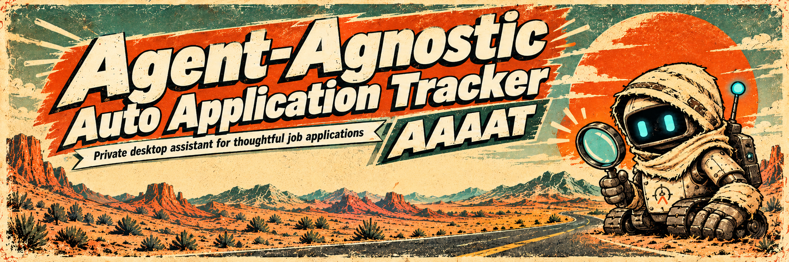

# AAAAT — Agent-Agnostic Auto Application Tracker

**Keep the offer. Find it fast. Make the document.**

AAAAT is a free, open-source desktop workspace for thoughtful job applications. Keep opportunities and original source material, reuse your career information, and make editable CVs, cover letters and PDFs. Your information lives in a local folder you choose. AI is optional.

[Website](https://didacll.github.io/AAAAT/) · [Get Started](https://didacll.github.io/AAAAT/get-started.html) · [Download AAAAT](https://github.com/DidacLL/AAAAT/releases/latest) · [User guide](docs/USER_GUIDE.md)


## Useful work, without a required workflow

| You want to… | AAAAT gives you… |
| --- | --- |
| Keep an offer or recruiter message | Original Sources beside editable details, including sparse records |
| Recognize the right opportunity | Search, content-driven covers, expanded context and shared Tag definitions |
| Stop rewriting your background | Reusable professional information, custom groups and saved wording variations |
| Make a document your own | Independent CV and letter editing, reusable templates, three PDF styles, optional photo/banner and retained source projects |
| Get help when useful | Optional configured AI, bounded external-assistant tools and editable copy-paste requests as a fallback |

There is no required application stage or completeness checklist. AAAAT does not discover opportunities or submit applications for you. Applications and documents are independently useful.

Use a compatible local assistant through **Settings → AI → Connect another AI → Connection setup**. The packaged app supplies its command and `--mcp --workspace` arguments for an MCP host. Prepare an application task or select its document access in AAAAT; the connection exposes only the relevant bounded work. [Connection guide](https://didacll.github.io/AAAAT/explore.html#connected-ai) · [Download assistant instructions](https://didacll.github.io/AAAAT/assets/skills/SKILLS.md). Copy-paste requests are available when a host cannot connect.

## Start simply

Install the package for your device and open AAAAT. First launch offers **PDF generation** and **Local AI**; select either or both and complete **Set up**, or return to them later. Choose **New workspace** in an empty folder for your own information. Installed packages include the application runtime; Node.js and npm are unnecessary for ordinary use.

Choose **Open demo** in a separate empty folder to explore 12 fictional opportunities across community work, editorial work, visitor services and other professions. Alex Morgan’s fictional background includes reusable information, a custom Community work group, a wording variation, CVs, a letter and a composition template. The demo uses mixed field prominence; use favourite stars and the field gear to choose the details and sizes that work for your search.

[First minutes](https://didacll.github.io/AAAAT/get-started.html) · [Explore the capabilities](https://didacll.github.io/AAAAT/explore.html) · [Installation details](docs/INSTALLATION.md)

Packages cover Windows, macOS and Linux on x64 and ARM64. They are unsigned and there is no automatic updater. PDF generation requires compatible pdfLaTeX; AAAAT can help set it up. Local AI setup is optional, as are independently configured providers.

## One developer, substantial AI engineering work

AAAAT is also an experiment in one human directing AI assistants through investigation, implementation, review and documentation. The human Product Owner defines the product and decides what ships. Persuasive AI answers and green checks can still protect wrong assumptions; inspecting the real product and correcting those assumptions is part of the work.

[How it’s built](https://didacll.github.io/AAAAT/how-its-built.html) · [Product Definition](PRODUCT_DEFINITION.md) · [Agent instructions](AGENTS.md) · [Technical architecture](docs/SPEC.md)

## Build from source

Use a current Node.js LTS release and its bundled npm. The locked dependencies declare their actual tool requirements.

```sh
git clone https://github.com/DidacLL/AAAAT.git
cd AAAAT
npm ci
npm start
```

`npm run make` creates native packages under `out/make/`. Windows builds additionally require [Inno Setup 6](https://jrsoftware.org/isdl.php); select a nonstandard compiler location with `ISCC_PATH`. The release workflow builds native installers and portable ZIPs for all six platform/architecture combinations.

## Help improve AAAAT

[Report a problem or idea](https://github.com/DidacLL/AAAAT/issues) with what you tried, what happened and a small fictional example. Keep private applications, documents and credentials out of public reports; see [Security](SECURITY.md).

[Contributing](CONTRIBUTING.md) · [Detailed user guide](docs/USER_GUIDE.md) · [Development principles](OWNER_DEVELOPMENT_PRINCIPLES.md)
